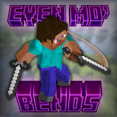

# Even Mo' Bends

Minecraft 1.7.10 fork of Mo' Bends 0.20.1, with Salamander models and animations, resource-pack support and an expressive skin editor.



[](https://github.com/JackOfNoneTrades/EvenMoBends/releases)
[](https://67.fentanylsolutions.org/mod/even-mo-bends)

[](https://discord.gg/xAWCqGrguG)

<!--
[](https://www.curseforge.com/minecraft/mc-mods/even-mo-bends)
[](https://modrinth.com/mod/even-mo-bends)
[](https://maven.fentanylsolutions.org/#/releases/net/gobbob/mobends/EvenMoBends)
-->

## Features

Segmented player, zombie, zombie villager, zombie pigman, spider and cave spider animations. Salamander loads and
renders the model geometry and evaluates the Blockbench/GeckoLib animation files. Resource packs can replace those
assets; see the [Blockbench guide](blockbench/README.md) for exporting projects and editing animations.

Eating and drinking raise the hand holding the item, including Backhand's off hand, while the rest of the body can
keep moving. Holding food alone does not trigger the animation. Set `animations.player.eating=false` in `mobends.cfg`
to disable it. The player animation switches also cover movement, combat, swimming, crawling and rowing.

## Dependencies

* [Salamander](https://github.com/JackOfNoneTrades/Salamander) is required. This development branch targets
  `8e5a945-snapshot`; older builds without its public CEM/player-skin APIs are incompatible.
* Salamander also requires [GTNHLib](https://github.com/GTNewHorizons/GTNHLib) 0.11.30 or newer and a compatible
  mixin bootstrap such as [UniMixins](https://github.com/LegacyModdingMC/UniMixins).
* Just Expressions and Fresh Moves are optional, separately installed resource packs. No pack artwork is bundled.

## Compatibility

Every row below includes the required Salamander installation. A matching, enabled CEM pack takes priority over
Mo' Bends for that entity. Player packs replace the whole player model and its animations, including eating;
the editor does not splice pack eyes onto the Mo' Bends body. Use one player pack at a time; normal resource-pack
priority decides which model wins if several are enabled. Removing the pack or disabling CEM restores Mo' Bends.

| Installed mods | Player renderer | Mob animations |
| --- | --- | --- |
| Even Mo' Bends | Mo' Bends through Salamander | Enabled |
| WawelAuth + Even Mo' Bends | Mo' Bends with WawelAuth skins and modern-skin support | Enabled |
| SimpleSkinBackport + Even Mo' Bends | Mo' Bends with modern skins, slim arms and segmented skin layers | Enabled |
| Backhand + Just A Shield + Even Mo' Bends | Mo' Bends with per-hand blocking poses, including passive shield blocking | Enabled |
| Aqua Acrobatics + Even Mo' Bends | Mo' Bends limbs with AA's swimming/crawling poses and whole-body transforms | Enabled |
| GTNH Et Futurum Requiem + Even Mo' Bends | Mo' Bends with EFR-aware Elytra flight and rowing poses | Enabled |
| Smart Moving (with or without WawelAuth) | Smart Moving / Smart Render; Mo' Bends player features disabled | Enabled |
| Just Expressions / Fresh Moves | Salamander renders the pack's player model | Mo' Bends for uncovered mobs |
| A matching zombie, zombie villager or spider CEM pack | Mo' Bends unless a player pack is also active | Salamander renders the pack's model for covered mobs |

EFR boat drivers follow each paddle independently, including turns and coasting. Boats, chest boats,
and rafts use their own handle and seat positions; rear passengers sit without rowing.
The paddles settle into an advanced resting position for a more relaxed arm pose, with eased starts and stops.
Set `animations.player.rowing=false` in `mobends.cfg` to use the ordinary riding pose instead.

Aqua Acrobatics supplies the swimming/crawling state and body rotation; Mo' Bends animates the segmented limbs.
Stopping or touching the bottom keeps AA's prone pose, and ordinary movement in water uses upright treading.
Set `animations.player.crawling=false` to disable the crawl limb cycle while keeping the low pose needed to fit.
The `swimming` animation switch also controls AA's swimming limb cycle.

## Expressive skin editor

Open the Even Mo' Bends menu (default `G`) and choose **Prepare Expressive Skin**. Choose an eye shape and
height, then use the arrows to edit pupils, eye whites, eyelids, eyebrows, outer-layer brows and eyelashes.
Each color page has a picker, a hex field and a skin eyedropper. Left/right refer to the preview; choose **Both**
to apply presets to both sides. Right-click erases optional colors or resets backgrounds. `Ctrl+Z` undoes a stroke
or preset; `Ctrl+Y` (or `Ctrl+Shift+Z`) redoes it. **Clear feature** affects the current feature and selected side.

Export a PNG or use the Wawel Auth upload button, which asks for confirmation before replacing your skin.
Enable **Just Expressions** or the **Animated Eyes** version of **Fresh Moves** to see expressions through
Salamander. Saving a draft does not change your active skin or enable a pack.

The editor writes the shared layout used by Just Expressions 1.2.1 and Fresh Moves 3.1.1:

* Base-face 2x1, 2x2 and 2x3 eyes, derp eyes, 3x1 Enderman eyes, wide-set eyes, and simple one-pixel-wide blinking eyes.
* Paired, wide-set and joined eyebrows, with separately editable colors and skin covers.
* Outer-layer eyebrows and eyelashes for bottom-positioned 2x2 eyes.

It accepts 64x64 and 64x32 skins and preserves visible skin pixels. Presets use supported positions and pupil
shapes; validation catches incompatible combinations, inconsistent colors, HD skins and eyes on the hat layer
before export or upload. Hover the status text to read longer explanations. See the
[pack skin guide](https://github.com/IthanMendoza/Fresh-Moves/wiki) for the underlying format.

Only unambiguous current pack data is loaded. Old Mo' Bends/ETF expression data is not imported; start a new
setup with the presets. Export clears the reserved expression areas before writing the new features, preventing
stray corner pixels from becoming black eyes or brows. Existing skins are not automatically rewritten.

The preview offers automatic motion, open/closed eyes and four gaze directions. It is a color and placement aid;
the active pack controls final expression motion. The editor prepares the facial features supported by those
packs, rather than authoring animation timelines. Mo' Bends' separate player/pig blink renderer and `blinking.*`
settings have been retired.

## Building

See the [0.0.3 release checklist](RELEASE_CHECKLIST.md) for migration validation and remaining publication work.

```sh
./gradlew build
```

To additionally check both classic and slim models and the editor's UV layout against original pack ZIPs, without
bundling them in the project:

```sh
EXPRESSION_PACKS='/path/to/JustExpressions_v1.2.1.zip:/path/to/FreshMoves-3.1.1-AnimatedEyes.zip' ./gradlew test --tests '*ExpressionPackTest' --rerun-tasks
```

Use your operating system's path separator between ZIPs (`:` on Linux/macOS, `;` on Windows).

It can additionally load makamys' Smart Moving stack without making it a published dependency:

```sh
./gradlew -PsmartMoving runClient25
```

To test SimpleSkinBackport instead of Wawel Auth, supply an SSB development jar:

```sh
./gradlew -PsimpleSkinBackportJar=/path/to/simpleskinbackport-dev.jar runClient25
```

Wawel Auth remains available for compilation and tests, but is excluded from this client's runtime.

Backhand is always in the development client. To test it with Just A Shield, supply a Just A Shield development jar:

```sh
./gradlew -PjustAShieldJar=/path/to/targaseule-dev.jar runClient25
```

This can be combined with `-PsimpleSkinBackportJar=...`.

To test Aqua Acrobatics, supply its development jar. This can be combined with the options above:

```sh
./gradlew -PaquaAcrobaticsJar=/path/to/aquaacrobatics-dev.jar runClient25
```

## Credits

* [Iwo Plaza / GobBob](https://www.curseforge.com/minecraft/mc-mods/mo-bends), creator of Mo' Bends.
* [makamys](https://github.com/makamys/SmartMoving), maintainer of the Minecraft 1.7.10 Smart Moving fork used for compatibility testing.
* [GTNH Et Futurum Requiem](https://github.com/GTNewHorizons/Et-Futurum-Requiem), whose optional API supplies Elytra flight and boat paddle state.
* [Salamander](https://github.com/JackOfNoneTrades/Salamander), for model rendering, animation evaluation and CEM support.
* [FreshLX / Ithan Mendoza](https://github.com/IthanMendoza/Fresh-Moves), for the Just Expressions / Fresh Moves skin layout used by the editor.
* [GT:NH buildscript](https://github.com/GTNewHorizons/ExampleMod1.7.10).

See [UPSTREAM.md](UPSTREAM.md) for exact source and binary provenance.

## License

Mixed MIT and GPL-3.0-or-later; see [LICENSE](LICENSE) for details.

## Buy me some creatine

* [ko-fi.com](https://ko-fi.com/jackisasubtlejoke)
* Monero: `893tQ56jWt7czBsqAGPq8J5BDnYVCg2tvKpvwTcMY1LS79iDabopdxoUzNLEZtRTH4ewAcKLJ4DM4V41fvrJGHgeKArxwmJ`
