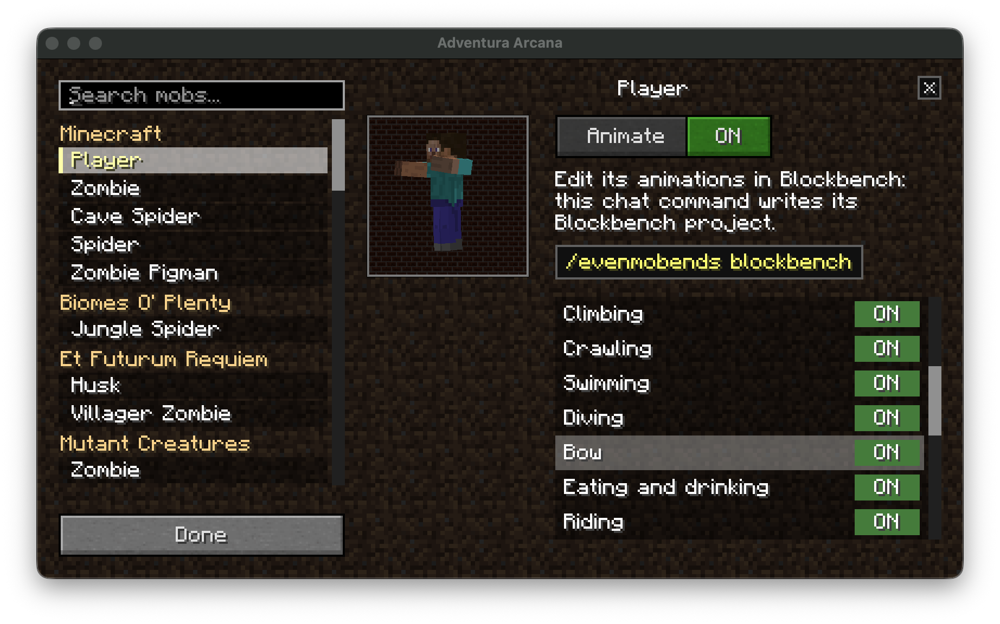

# Even Mo' Bends

Mo' Bends for Minecraft 1.7.10: segmented player and mob animations, drawn by Salamander and editable in Blockbench.

<!-- Not published yet

-->

## Features

* Bending animations for players, zombies, zombie pigmen, spiders and cave spiders.
* Other mods' zombies and spiders: Special Mobs, Et Futurum Requiem, Village Names, Wild Mobs, and any mod that draws
  the vanilla model (Twilight Forest, Natura, Biomes O' Plenty, ...).
* Face-only player packs such as Just Expressions animate the face on Mo' Bends' head.
* Animations are Blockbench projects that resource packs can replace: see the [Blockbench guide](blockbench/README.md).
* A switch per mob and per player animation, with live previews and search, in the mod's config screen.
* Client side only.

## Compatibility

| Mod | Support |
| --- | --- |
| Wawel Auth | Skins and capes |
| Salamander CEM packs | A pack's model replaces Mo' Bends for that mob; face-only player packs are combined |
| Et Futurum Requiem | Elytra, rowing, husks, zombie villagers |
| Aether, Avaritia, Adventure Backpack | Equipment on the limbs |
| Backhand, Just A Shield | Per-hand blocking |
| Aqua Acrobatics | Swimming and crawling |
| Wall Grab, Tuck & Roll | Their poses |
| Smart Moving | Takes over the player |

## Commands

* `/evenmobends blockbench [slim|classic|zombie|spider]`: exports a Blockbench project to `.minecraft/mobends/blockbench/`.
* `/evenmobends play <file> <animation>`, `/evenmobends stop`: loops an animation on yourself.

## Dependencies

* [Salamander](https://github.com/AngelicIndustries/Salamander)    0.0.3 or newer
* [GTNHLib](https://modrinth.com/mod/gtnhlib)   
* [UniMixins](https://modrinth.com/mod/unimixins)   
* Optional: [Wawel Auth](https://github.com/AngelicIndustries/WawelAuth)    

## Building

`./gradlew build`. `-PsalamanderJar=<dev jar>` and `-PwawelAuthJar=<dev jar>` build against local jars.

## Credits

* [Mo' Bends](https://www.curseforge.com/minecraft/mc-mods/mo-bends) by Iwo Plaza / GobBob
* [Smart Moving](https://github.com/makamys/SmartMoving), makamys' 1.7.10 fork
* [GTNH Et Futurum Requiem](https://github.com/GTNewHorizons/Et-Futurum-Requiem), for its Elytra and boat API
* [GT:NH buildscript](https://github.com/GTNewHorizons/ExampleMod1.7.10)

Source provenance: [UPSTREAM.md](UPSTREAM.md).

## License

MIT for Mo' Bends' code and assets, GPL-3.0-or-later for the animations derived from Smart Moving, so builds are
GPL-3.0-or-later. See [LICENSE](LICENSE).

## Buy me some creatine

* [ko-fi.com](https://ko-fi.com/jackisasubtlejoke)
* Monero: `893tQ56jWt7czBsqAGPq8J5BDnYVCg2tvKpvwTcMY1LS79iDabopdxoUzNLEZtRTH4ewAcKLJ4DM4V41fvrJGHgeKArxwmJ`
