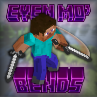

# Even Mo' Bends

Minecraft 1.7.10 fork of Mo' Bends 0.20.1: segmented player and mob animations, drawn by Salamander and editable in Blockbench.



[](https://github.com/AngelicIndustries/EvenMoBends/releases)
[](https://67minecraft.com/mod/even-mo-bends)

[](https://discord.gg/xAWCqGrguG)

<!-- Not published yet
[](https://www.curseforge.com/minecraft/mc-mods/even-mo-bends)
[](https://modrinth.com/mod/even-mo-bends)
[](https://maven.angelic.industries/#/releases/net/gobbob/mobends/EvenMoBends)
-->

## Features

* Segmented player, zombie, zombie villager, zombie pigman, spider and cave spider animations. Salamander loads and
  draws the model geometry and evaluates the Blockbench/GeckoLib animation files.
* Resource packs can replace those models and animations; see the [Blockbench guide](blockbench/README.md) for
  exporting projects and editing animations.
* Skin layers, flat or 3D, are drawn by Salamander on Mo' Bends' joints.
* Eating and drinking raise the hand holding the item, including Backhand's off hand, while the rest of the body keeps
  moving. Holding food alone does not trigger it.
* A switch per player animation: movement, combat, swimming, crawling, rowing, eating and more.
* Only the client needs it. Clients without Even Mo' Bends can join servers that have it.

### Settings

The config screen (Mods, Even Mo' Bends, Config) has:

* **Animations**: the mob menu, one screen. On the left, a search field (by mob or mod name) over every mob Mo' Bends
  animates, vanilla's first, then other mods' under each mod's name (Special Mobs, Et Futurum Requiem, Twilight
  Forest, ...), scrolling when they don't fit. Mobs of those kinds that their mod draws its own way are listed greyed
  out, saying why. Clicking a mob shows it on the right: a preview, its own **Animate** switch, which takes effect at
  once, and the command that writes its rig's Blockbench project, which copies on click. Clicking it again, or the
  x in its header, goes back to the showcase: a player model turning and cycling through its animations, its cape
  swinging as it moves. The switches are the `Animate` category of `config/mobends.cfg`, by entity name, such as
  `B:"TwilightForest.King Spider"=false`; vanilla's player, zombie, spider and cave spider keep their old keys. The
  **Player** also lists its animations: click one to preview it, and its switch to turn it on or off, at once; those
  are `animations.player.*`, for example `animations.player.eating=false`. The right side says when something else
  draws a mob in Mo' Bends' place: a resource pack's model (naming the pack), another mod's renderer, or its switch
  being off. Escape clears the search first, then leaves. The menu works from the main menu too, without a world.
* **General**: the sword trail, **Combine face-only player packs** (on by default; see
  [Compatibility](#compatibility)) and **Animate other mods' spiders and zombies** (on by default).

The G key and the old in-game menu are gone.

### Commands

* `/evenmobends blockbench`: writes `.minecraft/mobends/blockbench/player.bbmodel` (or `player_slim.bbmodel`) with
  your skin. Add `slim` or `classic` to override the arm width, or `zombie` or `spider` for those mobs.
* `/evenmobends play <file> <animation>`: loops an animation on yourself. Files are under `geckolib/animations/`, for
  example `player/item_test`. `/evenmobends stop` ends it.

### Expressions

The expression editor moved to [Salamander](https://github.com/AngelicIndustries/Salamander/wiki/Expression-Editor),
which draws the eyes and brows through Just Expressions and Fresh Moves. Mo' Bends' own player and pig blinking and
its `blinking.*` settings are retired.

### Compatibility

Every row below includes the required Salamander installation. A matching, enabled CEM pack takes priority over
Mo' Bends for that entity. Player packs replace the whole player model and its animations, including eating; pack
eyes are not added to the Mo' Bends body. Use one player pack at a time; normal resource-pack priority decides which
model wins if several are enabled. Removing the pack or disabling CEM restores Mo' Bends.

| Installed mods | Player renderer | Mob animations |
| --- | --- | --- |
| Even Mo' Bends | Mo' Bends through Salamander | Enabled |
| Wawel Auth + Even Mo' Bends | Mo' Bends with Wawel Auth's skins, layers drawn by Salamander | Enabled |
| The Aether + Even Mo' Bends | Mo' Bends with gloves, pendant, shield, cape, wings, halo and agility boots on the limbs | Enabled |
| Avaritia + Even Mo' Bends | Mo' Bends with the infinity armor's every effect on the limbs | Enabled |
| Adventure Backpack + Even Mo' Bends | Mo' Bends with backpacks, the copter pack and the coal jetpack on the body; flying on a pack uses the flight pose | Enabled |
| Wall Grab / Tuck & Roll + Even Mo' Bends | Mo' Bends limbs in the wall grab and tuck poses | Enabled |
| Backhand + Just A Shield + Even Mo' Bends | Mo' Bends with per-hand blocking poses, including passive shield blocking | Enabled |
| Aqua Acrobatics + Even Mo' Bends | Mo' Bends limbs with AA's swimming/crawling poses and whole-body transforms | Enabled |
| GTNH Et Futurum Requiem + Even Mo' Bends | Mo' Bends with EFR-aware Elytra flight and rowing poses | Enabled, including EFR's zombie villagers and husks |
| Special Mobs + Even Mo' Bends | Mo' Bends | Its zombies, zombie pigmen, spiders and cave spiders animate as the vanilla ones, with their own textures, eyes and sizes |
| Wild Mobs + Even Mo' Bends | Mo' Bends | Its zomgus animates as a zombie, with its mushrooms growing from the bent head, right arm and left forearm |
| Other mods' spiders and zombies | Mo' Bends | Enabled for any mod whose renderer draws the vanilla spider or zombie model and only picks its texture, size, eyes or tint: in Adventura Arcana, Biomes O' Plenty's jungle spiders, Natura's heatscar spiders, Twilight Forest's hedge, king and swarm spiders, redscale broodlings and lich minions, Wild Mobs' tarantulas and faded, and Uralte Zauber's spider minions. Mobs with a drawing of their own (Uralte Zauber's zombie minions) keep their mod's look. The mob menu lists each of them, with its own switch |
| Village Names + Even Mo' Bends | Mo' Bends | Enabled with its modern zombie skins: zombie villagers keep Village Names' biome, profession and level skins and hats |
| Smart Moving (with or without Wawel Auth) | Smart Moving / Smart Render; Mo' Bends player features disabled | Enabled |
| Just Expressions + Even Mo' Bends | Mo' Bends animates the body; Salamander draws the pack's animated face on Mo' Bends' head | Enabled |
| Fresh Moves, or another player pack that changes the body | Salamander renders the pack's player model | Mo' Bends for uncovered mobs |
| A matching zombie, zombie villager or spider CEM pack | Mo' Bends unless a player pack is also active | Salamander renders the pack's model for covered mobs |

Salamander tells a face-only player pack from one that changes the body: a pack whose player parts keep vanilla's
boxes and whose animations move only what it adds on the head, such as Just Expressions, is face-only. Mo' Bends then
keeps the body and Salamander draws the pack's face on Mo' Bends' head, blinking and looking around as the pack
animates it. Any other player pack, such as Fresh Moves, replaces the player. Turn off **Combine face-only player
packs** to let face-only packs replace the player too. This needs Salamander 0.0.3; older Salamanders let every
player pack replace the player.

EFR boat drivers follow each paddle independently, including turns and coasting. Boats, chest boats,
and rafts use their own handle and seat positions; rear passengers sit without rowing.
The paddles settle into an advanced resting position for a more relaxed arm pose, with eased starts and stops.
Set `animations.player.rowing=false` to use the ordinary riding pose instead.

Aqua Acrobatics supplies the swimming/crawling state and body rotation; Mo' Bends animates the segmented limbs.
Stopping or touching the bottom keeps AA's prone pose, and ordinary movement in water uses upright treading.
Set `animations.player.crawling=false` to disable the crawl limb cycle while keeping the low pose needed to fit.
The `swimming` animation switch also controls AA's swimming limb cycle.

Players don't take the fighting stance on joining a world or in other mods' previews, such as Wawel Auth's account
manager.

## Dependencies

* [Salamander](https://github.com/AngelicIndustries/Salamander) [](https://www.curseforge.com/minecraft/mc-mods/salamander) [](https://67minecraft.com/mod/salamander) [](https://github.com/AngelicIndustries/Salamander/releases),
  0.0.3 or newer: it draws the models, the animations and the skin layers.
* [GTNHLib](https://modrinth.com/mod/gtnhlib) [](https://www.curseforge.com/minecraft/mc-mods/gtnhlib) [](https://modrinth.com/mod/gtnhlib) [](https://github.com/GTNewHorizons/GTNHLib/releases),
  0.11.30 or newer, required by Salamander.
* [UniMixins](https://modrinth.com/mod/unimixins) [](https://www.curseforge.com/minecraft/mc-mods/unimixins) [](https://modrinth.com/mod/unimixins/versions) [](https://github.com/LegacyModdingMC/UniMixins/releases),
  required by Salamander.
* Optional: [Wawel Auth](https://github.com/AngelicIndustries/WawelAuth) [](https://www.curseforge.com/minecraft/mc-mods/wawel-auth) [](https://modrinth.com/mod/wawel-auth) [](https://67minecraft.com/mod/wawel-auth) [](https://github.com/AngelicIndustries/WawelAuth/releases),
  for players' skins from their own auth providers.
* Optional: the Just Expressions and Fresh Moves resource packs, installed separately. No pack artwork is bundled.

## Building

```sh
./gradlew build
```

To build against a local Salamander or Wawel Auth development jar:

```sh
./gradlew -PsalamanderJar=/path/to/salamander-dev.jar -PwawelAuthJar=/path/to/wawelauth-dev.jar build
```

The development client can also load makamys' Smart Moving stack without making it a published dependency:

```sh
./gradlew -PsmartMoving runClient25
```

Backhand is always in the development client. To test it with Just A Shield, supply a Just A Shield development jar:

```sh
./gradlew -PjustAShieldJar=/path/to/targaseule-dev.jar runClient25
```

To test Aqua Acrobatics, supply its development jar. This can be combined with the options above:

```sh
./gradlew -PaquaAcrobaticsJar=/path/to/aquaacrobatics-dev.jar runClient25
```

## Credits

* [Iwo Plaza / GobBob](https://www.curseforge.com/minecraft/mc-mods/mo-bends), creator of Mo' Bends.
* [makamys](https://github.com/makamys/SmartMoving), maintainer of the Minecraft 1.7.10 Smart Moving fork used for compatibility testing.
* [GTNH Et Futurum Requiem](https://github.com/GTNewHorizons/Et-Futurum-Requiem), whose optional API supplies Elytra flight and boat paddle state.
* [Salamander](https://github.com/AngelicIndustries/Salamander), for model rendering, animation evaluation and CEM support.
* [GT:NH buildscript](https://github.com/GTNewHorizons/ExampleMod1.7.10).

See [UPSTREAM.md](UPSTREAM.md) for exact source and binary provenance.

## License

Mixed MIT and GPL-3.0-or-later; see [LICENSE](LICENSE) for details.

* Code and assets from Mo' Bends, and fork work not marked otherwise: MIT ([LICENSES/MIT.txt](LICENSES/MIT.txt)).
* Animations derived from Smart Moving: GPL-3.0-or-later ([LICENSES/GPL-3.0-or-later.txt](LICENSES/GPL-3.0-or-later.txt)),
  so combined builds are distributed under GPL-3.0-or-later.

## Buy me some creatine

* [ko-fi.com](https://ko-fi.com/jackisasubtlejoke)
* Monero: `893tQ56jWt7czBsqAGPq8J5BDnYVCg2tvKpvwTcMY1LS79iDabopdxoUzNLEZtRTH4ewAcKLJ4DM4V41fvrJGHgeKArxwmJ`
